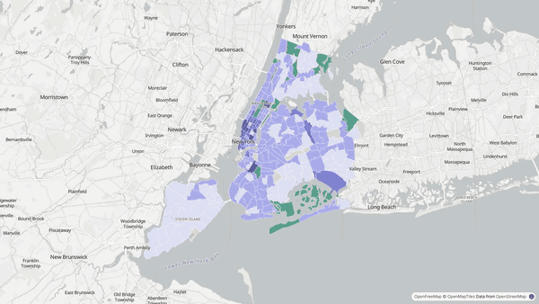
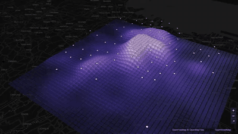

### Hi, I'm Dhanes

Senior Data Scientist with 8+ years across telecom, banking, geospatial and commerce, building causal models and LLM-powered data products. Now doing an MPhil in Smart Mobility at Hiroshima University (Urban and Data Science Lab).

**CV and portfolio:** [dhaneswara-mandrasa.vercel.app](https://dhaneswara-mandrasa.vercel.app) 
**CV (PDF):** [download](https://dhaneswaramandrasa.github.io/Dhaneswara_Mandrasa_CV.pdf) 
**LinkedIn:** [linkedin.com/in/dhaneswaramandrasa](https://www.linkedin.com/in/dhaneswaramandrasa) 
**Email:** dhaneswara.mandrasa@gmail.com

**Current research:** I build LLM feature-extraction pipelines that turn unstructured geospatial text into reliable, validated features for causal and demand models. Current work: using NYC's January 2025 congestion toll as a natural experiment on millions of ride-hail trips, I test whether LLM-scored place features improve price-response and welfare estimates against a no-LLM baseline.

   
  <a href="https://dhaneswara-mandrasa.vercel.app/nyc-3d"><b>▶ Explore New York in 3D</b></a>: GeoTraitVec place traits for 261 taxi zones and the congestion toll zone. Thesis code is private for now; <a href="https://dhaneswara-mandrasa.vercel.app/project-thesis">read the write-up</a>.

### Projects you can open in the browser

<table>
  <tr>
    <td width="50%" valign="top">
      
      <b><a href="https://github.com/dhaneswaramandrasa/omni-market-intelligence">Omni Market Intelligence</a></b> 
      Who ordered what, where, today? App markets estimated from telco traffic, area by area.
    </td>
    <td width="50%" valign="top">
      
      <b><a href="https://github.com/dhaneswaramandrasa/persona-atlas">Persona Atlas</a></b> 
      Telco behaviour into personas and look-alike audiences.
    </td>
  </tr>
  <tr>
    <td width="50%" valign="top">
      
      <b><a href="https://github.com/dhaneswaramandrasa/alt-credit-scoring">Alternative Credit Scoring</a></b> 
      A credit score for people with no credit file, from top-ups, tenure and where the phone sleeps at night.
    </td>
    <td width="50%" valign="top">
      
      <b><a href="https://github.com/dhaneswaramandrasa/retail-site-selection">Retail Site Selection</a></b> 
      Where to open the next store: every map cell scored from demographics, places and mobility.
    </td>
  </tr>
  <tr>
    <td width="50%" valign="top">
      
      <b><a href="https://github.com/dhaneswaramandrasa/ses-satellite">SES from Satellite Imagery</a></b> 
      Socio-economic status for every map cell from satellite images, at 1 km and then 100 m.
    </td>
    <td width="50%" valign="top">
      
      <b><a href="https://github.com/dhaneswaramandrasa/plantation-root-cause">Root-Cause Diagnosis for Plantation Yield</a></b> 
      Is a weak block the land, the pesticide or the species? Click a block to see the diagnosis.
    </td>
  </tr>
</table>

All demos run on simulated or open data. Client work stays confidential.

**What I work with:** causal inference (difference-in-differences), discrete choice and ICLV models, XGBoost and SHAP, LLM prompt design and evaluation, Python, SQL, PySpark, Snowflake, Databricks, geospatial data.

**Open to:** remote roles in data science, applied AI, pricing and marketplace analytics, and mobility or transport data.
